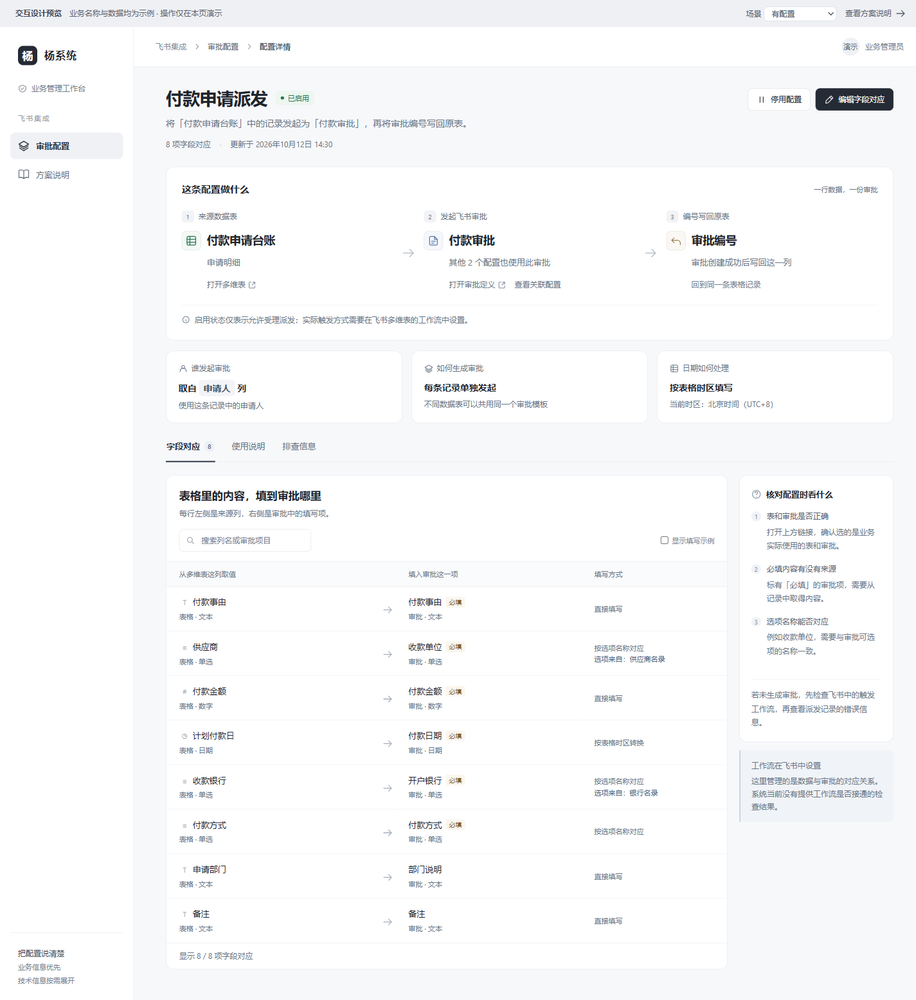

# 审批配置业务视角改版 — 设计

> - 日期：2026-10-12。
> - 状态：**用户已确认方案，独立工作树已实施并完成本地验收**。本文记录已通过的 HTML 方案及实现要求；实现证据见[验收记录](approval-config-business-view/implementation.md)，云端尚未部署。
> - 使用对象：需要维护审批派发配置的业务人员；技术人员通过「排查信息」核对底层标识。
> - 范围：审批配置列表、查看配置、字段对应说明与现有编辑能力的呈现。派发执行、编号回填和派发记录的业务行为沿用既有契约。
> - 评审依据：[交互原型](approval-config-business-view/prototype.html)、[列表截图](approval-config-business-view/list.png)、[详情截图](approval-config-business-view/detail.png)、[窄屏截图](approval-config-business-view/mobile.png)。原型及图片原样归档。

## 一、目标与已确认决策

业务人员进入页面后，应能回答五个问题：哪张表发起什么审批、谁作为申请人、每个审批项从哪一列取值、审批编号写回哪里，以及这条配置是否允许派发。

| 位置 | 已确认方案 | 收益与代价 |
|---|---|---|
| 配置列表 | 配置名称、来源数据表、发起的审批、配置状态、查看配置 | 能按业务名称识别配置；需要补展示元数据和名称搜索 |
| 查看配置 | 独立详情视图，顶部展示「来源数据表 → 发起飞书审批 → 编号写回原表」 | 看清完整关系；返回列表时需要保留筛选、页码与滚动位置 |
| 字段对应 | 表格列 → 审批项目，中文填写规则、必填提示、可选说明示例 | 降低阅读成本；需要把转换规则准确翻译成业务文案 |
| 技术信息 | 集中到「排查信息」，保留复制与展开细节 | 默认页面更易读；排查时多一步切换 |
| 状态 | 只显示已知事实，明确启用开关与实际运行结果的区别 | 避免把「启用」或「缓存时间」误读为工作流接通或运行成功 |
| 视觉 | 沿用现有控制台中性色、细边框、深色主按钮与状态色 | 与既有页面一致，复用当前组件体系 |

本次不增加工作流编辑器或自动健康检查。创建向导、通用编辑、删除和派发记录入口继续保留；原型覆盖重点是配置阅读，不是全部管理操作的替代品。

## 二、方案评审时现状

以下记录方案评审时的代码行为，供理解改版原因；实施后的行为和验证结果见[实现验收记录](approval-config-business-view/implementation.md)。

| 代码位置 | 当前行为 | 改版要解决的问题 |
|---|---|---|
| [ApprovalConfigsPage.tsx](../../frontend/src/features/feishu/views/ApprovalConfigsPage.tsx)，`ApprovalConfigsPage` / `FragmentRow` | 列表展示坐标、审批 Code、时区、快照时间等；查看配置展开映射行 | 技术信息占据主阅读区域，缺少完整的业务关系说明 |
| 同文件，`MapDetailRow` | 字段名称与字段 ID、控件 ID、原始类型、converter 并列 | 业务人员需要理解技术术语才能读懂填写规则 |
| [list_configs.rs](../../src/addon/feishu/approval/actions/list_configs.rs)，`ConfigItem` | 返回配置标题、坐标、申请人列标识、回填列标识、时区、状态、结构缓存时间和映射 | 缺少独立的多维表名称、数据表名称、审批名称及申请人、回填列展示名称 |
| 同文件，`FieldMapItem` | 已有来源列名、审批项名、必填标记、转换规则及外部选项来源 key | 可以复用名称；外部选项来源还需要业务展示名称 |
| [types.ts](../../frontend/src/features/feishu/types.ts)、[api.ts](../../frontend/src/features/feishu/api.ts) | 有列表类型、解析器、分页查询及读写权限控制 | 新增展示字段、搜索和详情必须同步类型及查询契约 |
| [ApprovalConfigDialog.tsx](../../frontend/src/features/feishu/components/ApprovalConfigDialog.tsx) | 已有创建、编辑与技术信息开关 | 复用现有能力和校验，避免建立第二套配置提交链路 |
| [approval/table.rs](../../src/addon/feishu/approval/table.rs) | `(base_token, table_id)` 唯一 | 同一数据表只有一条配置；不同视图不能当作不同表 |
| [update_config.rs](../../src/addon/feishu/approval/actions/update_config.rs) | 可更新标题、启用状态、时区和字段对应；关键来源坐标固定 | 本次界面不能承诺切换来源表、审批模板、申请人列或编号回填列 |
| [approval_provision.rs](../../src/addon/feishu/domain/approval_provision.rs) | 获取表格字段和审批定义，校验后在事务内保存配置与映射 | 展示元数据补充应复用取数结果，保留现有校验、事务和审计 |

配置标题不能代替独立的审批名称。标题可编辑，也可能来自创建时的名称；它不是当前审批定义名称的可靠替身。

## 三、配置列表

页面标题为「审批配置」，说明为「看清每张表发起什么审批，以及数据如何填写。」

| 列 | 内容 |
|---|---|
| 配置名称 | 用户可辨认的配置标题；次级信息为「N 项字段对应」 |
| 来源数据表 | 第一行多维表名称，第二行具体数据表名称 |
| 发起的审批 | 审批模板的展示名称 |
| 配置状态 | 「已启用」或「已停用」，同时提供文字与视觉标记 |
| 操作 | 「查看配置」，配置名称也可进入详情 |

筛选提供「全部 / 已启用 / 已停用」。搜索提示为「搜索配置、数据表或审批」，范围包括配置标题、多维表名称、数据表名称和审批名称。

生产实现保留真实分页。搜索和筛选作用于全部配置，不能只在当前页做本地过滤。修改搜索或状态筛选时回到第一页；从详情返回时恢复进入详情前的条件、页码和滚动位置。总数、状态筛选数量和关联配置数量均应来自完整查询结果；未取得统计时可以省略数字，不能用当前页条数冒充总数。

保留「新建配置」及既有管理操作；只有写权限用户可以执行。只读用户仍能进入详情。列表默认不显示长标识、原始时区代码和结构缓存时间。

## 四、配置详情

### 4.1 顶部业务关系

详情是独立阅读视图，不再依赖列表展开行。标题区域展示配置名称、启用状态、字段对应数量、更新时间以及有权限的管理操作。

主体按以下顺序呈现：

1. **来源数据表**：多维表名称、数据表名称、「打开多维表」。
2. **发起飞书审批**：审批名称、「打开审批定义」、「查看关联配置」。
3. **编号写回原表**：目标列名称，说明编号写回同一条原记录。

其下展示三条业务规则：

| 标签 | 当前契约的展示 |
|---|---|
| 谁发起审批 | 「取自『申请人』列」，说明使用这条记录中的申请人 |
| 如何生成审批 | 「每条记录单独发起」，说明不同数据表可以共用同一个审批模板 |
| 日期如何处理 | 「按表格时区填写」，附当前配置时区的中文可读说明 |

「申请人」「审批编号」为示例列名，实际显示配置元数据。时区按 `base_timezone` 展示，不能将原型的「北京时间（UTC+8）」硬编码到所有配置，也不能以浏览器时区替换派发使用的时区。

业务关系表达配置意图，不保证当前记录已经成功创建或完成回填。编号展示、链接型字段支持及写入方式以既有后端契约为准，本次不改变字段存储格式。

### 4.2 同一审批的关联配置

以 `approval_code` 查找其他配置，展示配置名称、来源数据表和启用状态，并可跳转查看。可以包括已停用配置，但必须显示状态。

多个不同 `(base_token, table_id)` 可以对应同一个审批定义。每张表独立配置来源列、申请人列、回填列和字段对应；同一表的不同视图仍属同一配置。关联配置不能仅从当前列表页推算；没有取得完整数量时只显示「查看关联配置」。

### 4.3 字段对应

「字段对应」为默认标签页，标签附映射数量。按「表格列 → 审批项目 → 填写规则」展示，必填标记紧邻审批项；支持按来源列名和审批项名搜索。

| 底层信息 | 面向业务人员的表达 | 说明 |
|---|---|---|
| `direct` | 「直接填写」 | 将来源值填入对应审批项，仍受既有类型转换和校验约束 |
| `date` | 「按表格时区转换日期」 | 说明日期处理方式，具体日期精度沿用后端规则 |
| `option` | 「按名称匹配审批选项」 | 有外部选项来源时补充「选项来自：来源名称」；无法匹配时不暗示会自动新增选项 |
| 控件原始类型 | 「文本 / 数字 / 日期 / 单选 / 多选」等中文类型 | 按实际控件类型映射，不用原型示例类型推断真实字段 |
| `required` | 「必填」 | 表示审批项要求填写，不表示来源记录已经通过校验 |
| `widget_id`、`bitable_field`、`converter`、`option_source_key` | 放入「排查信息」 | 保留实际值，技术标识不混入主要列名 |

未知类型或规则使用「类型待确认 / 填写规则待确认」并保留排查信息，不能错误回退为「直接填写」。外部选项仍遵守现有匹配及歧义校验，界面文案不能覆盖实际失败原因。

可提供「显示填写示例」开关，默认不展示。示例用于说明，不读取真实记录来充当示例，不发送审批；显示时明确标记「填写示例仅用于解释，不代表实际表格内容」。未提供示例的字段可以不显示。

编辑入口继续走现有配置更新和服务端校验。当前可编辑配置标题、启用状态、时区和映射；来源表、审批定义、申请人列、编号回填列固定。更换这些固定项需要重新建立配置；同一表重建时先按现有规则处理原配置，不能创建第二条相同坐标的配置。名称暂缺本身不应使有稳定 ID 的配置失去查看能力，也不应成为新的权限限制。

### 4.4 使用说明

使用说明用三步解释实际操作：填写记录中的申请人和必填内容；通过飞书多维表工作流发出派发请求；审批创建并完成回写后在原记录查看审批编号。

固定提示为：「本页未检测工作流触发条件、权限或实际运行结果。请在飞书中核对工作流，运行问题通过派发记录排查。」

常见疑问至少覆盖：多张表能否共用审批、已启用为何仍未发起审批、如何更换固定来源或审批模板。触发方式说明为「在飞书多维表中设置」，可以举按钮触发为例，不能展示未经检测的「按钮工作流已接通」。

### 4.5 排查信息

集中展示配置编号、Base Token、Table ID、Approval Code、申请人列和编号回填列标识、配置时区、表单结构缓存时间。Base、数据表、审批标识提供复制动作，复制失败应有反馈。

字段标识、控件标识、原始类型、转换规则和外部选项来源 key 放入可展开区域。默认收起，避免技术信息重新占据详情首屏。排查区不展示管理 Token、飞书访问凭据或其他秘密。

`form_snapshot_at` 的产品名称为「表单结构缓存时间」，解释为「最近保存审批控件结构的时间；不代表配置检查通过，也不代表审批已经运行成功」。缺失时显示「尚无结构缓存时间」。

## 五、状态、异常与权限

| 场景 | 必须呈现的行为 |
|---|---|
| `enabled = true` | 显示「已启用」，含义仅为配置允许受理派发 |
| `enabled = false` | 显示「已停用」，说明新的派发请求不会通过此配置受理 |
| 启用确认 | 「启用后，此配置可受理新的派发请求；仍需飞书工作流触发。」 |
| 停用确认 | 「停用后，新的派发请求将不再通过此配置受理。」；不承诺取消已创建审批或撤回在途任务 |
| 首次加载 | 使用骨架或加载说明，不先渲染成空列表 |
| 查询失败 | 「暂时无法读取配置」，提供「重新加载」；失败不解释为配置被删除或停用 |
| 没有任何配置 | 「还没有审批配置」，提供配置步骤；有写权限时提供新建入口 |
| 搜索没有结果 | 「没有符合条件的配置」，提供清除筛选；字段搜索无结果时提示换关键词 |
| 名称元数据缺失 | 「表格名称待补充 / 数据表名称待补充 / 审批名称待补充 / 列名称待补充」，可去排查信息核对标识 |
| 零条字段对应 | 明确「暂无字段对应」，不显示已完成配置或可成功运行；有写权限时引导核对映射 |
| 详情已不存在 | 明确配置无法找到，允许返回列表；不从旧列表缓存伪造完整详情 |
| 保存失败 | 保留输入并显示可行动原因，不能先显示成功或擅自改变配置状态 |

读取沿用 `feishu.approval.read`，配置写入沿用 `feishu.approval.write`，选表向导仍遵守当前 `feishu.datasource.write` 要求。界面隐藏写操作不能替代后端鉴权。名称补充不能扩大用户读取真实表格记录的权限。

## 六、展示元数据与接口要求

### 6.1 名称来源和可信边界

采用「补元数据并保存展示快照，按批次补充旧配置」的方向。列表优先读取本地展示快照，不为每行同步调用飞书。创建及映射更新优先复用 provision 已读取的字段和审批定义；补充 Base、数据表名称时按唯一坐标批量去重，复用现有缓存和取数能力，不为本次改版新增独立后台服务。

| 展示信息 | 来源及处理规则 |
|---|---|
| 多维表名称、数据表名称 | 对应坐标的元数据快照；旧配置允许暂缺 |
| 审批名称 | 审批定义元数据，独立于用户可编辑的配置标题 |
| 申请人列名、编号回填列名 | 用已保存列 ID 从表格字段元数据中解析；不靠名称反推 ID |
| 来源列名、审批项名 | 复用已有字段名缓存及表单结构快照的控件名称 |
| 外部选项来源名称 | 按来源 key 读取已有数据源展示名称；缺失时明确提示待补充 |

名称仅用于展示和搜索；派发、白名单、映射匹配和回填仍使用稳定标识。飞书对象改名后展示快照可能暂旧；读取失败不能清空有效配置、覆盖已有名称为垃圾值或阻断派发。名称缺失不等于配置失效，名称存在也不等于对象仍可访问。

### 6.2 接口补充范围

在现有配置查询结果中补充可空的展示名称。建议语义字段如下；最终字段命名和持久化结构在实施时遵循当前强类型契约，不将这些建议误认为已经存在的字段：

| 层级 | 建议补充 |
|---|---|
| 配置 | `base_name`、`table_name`、`approval_name`、`applicant_field_name`、`backfill_field_name` |
| 映射 | `option_source_name`；若呈现来源列类型，需从真实字段元数据补充，不能从审批控件类型代替推断 |
| 查询 | 业务名称搜索；按审批定义查询关联配置及完整结果数量 |

详情必须能按稳定配置 ID 读取，不能只依赖当前列表页的数据。优先扩展已有查询能力满足详情和关联配置需求；只有已有契约无法满足时再增加 Action。查询缺失元数据时返回可空值，由前端显示明确缺失文案；不返回伪造名称。

生产数据变化走 `fields!` 与声明式 Schema 的安全增量同步，不新增 SQL 迁移文件。展示补充不改变当前坐标唯一键，不绕过 provision 校验、更新事务、鉴权或审计。

### 6.3 实施涉及位置

| 位置 | 后续改动职责 |
|---|---|
| `approval/actions/list_configs.rs` 及必要的查询能力 | 展示名称、完整搜索、分页、按 ID 详情和关联配置 |
| `approval/table.rs`、`domain/approval_provision.rs` 及现有元数据机制 | 可空展示快照、复用取数结果、旧配置补充；准确存储方式在实施时落定 |
| `frontend/src/features/feishu/views/ApprovalConfigsPage.tsx` | 业务列表、筛选分页、独立详情入口与返回状态 |
| 同域 `views/`、`components/` | 业务详情和标签页，复用现有 UI、编辑对话框、复制及提示能力 |
| `frontend/src/features/feishu/types.ts`、`api.ts` | 类型、解析器、查询参数及缓存失效 |
| `frontend/contracts/openapi.json`、`frontend/src/engine/contracts/api-types.ts` | 后端契约变更后运行 `python scripts/dump_openapi.py` 生成，禁止手改 |
| `frontend/tests/`、`frontend/e2e/` 与相关 Rust 测试 | 名称回退、分页搜索、详情状态、权限、编辑失败和接口兼容回归 |

前端业务实现归 `features/feishu/`，遵守 [frontend/AGENTS.md](../../frontend/AGENTS.md)。复用现有静态视图注册和路由机制，不新增第二套导航，也不为本次改版修改通用引擎分层。

## 七、与审批业务扩展的衔接

归档原型按当前「从表格人员列读取申请人、回填审批编号」的链路展示。另有独立的「审批可选回填扩展、发起人参数化与进度追踪」设计讨论，其中申请人来源和回填项目另有业务决策；该扩展不属于本工作树的实施范围。

若两项同时实施，申请人和回填行为以该业务扩展设计最终落地的接口契约为准，本页按实际配置展示「谁发起审批」「结果写回哪里」，同步修改使用说明及固定项提示。本文确认的是业务信息优先、独立详情及技术信息收起的呈现原则，不覆盖另一设计的业务决策，也不将待实现的扩展伪装为当前能力。归档 HTML 保留评审时的内容，不改写历史原型。

## 八、视觉、窄屏与可访问性

复用当前控制台组件和视觉规则，不引入新的设计系统、字体服务或动画依赖。正常页面不出现用于评审的「交互设计预览」工具条和场景切换按钮。

宽屏顺序为业务流程、三条规则、标签页与内容。窄屏流程改为纵向排列；映射内容保持来源与目标的关系，不让长标识撑出页面。必要的表格内部滚动需明确且不造成整页横向溢出。

状态必须有文字，不能仅靠颜色。标签页支持键盘切换和可见焦点；对话框提供可辨认标题、焦点管理、取消与确认。打开外部链接时使用真实可用 URL 和安全的新窗口属性。未知或无法构造的链接不伪造可点击入口。

## 九、验收标准与验证边界

实现按以下标准验收；完成的勾选以本地验证为依据，云端验证另行记录：

- [x] 列表默认以业务名称和配置状态识别配置，长标识进入排查区。
- [x] 名称搜索、启停筛选、总数和分页作用于完整配置集合；关联审批配置不受当前页截断。
- [x] 详情可按配置 ID 进入，返回列表恢复筛选、页码和滚动位置。
- [x] 详情能确认来源表、审批、申请人来源和回填位置；文案与实际业务契约一致。
- [x] 字段对应显示真实名称、真实类型、必填与中文规则，未知值不误译；示例与真实数据明确区分。
- [x] 缺少名称时仍可通过标识排查，不猜名字，不改变配置身份或派发行为。
- [x] 启用、停用、结构缓存时间不被解释为健康检查或运行成功。
- [x] 创建、通用编辑、删除和派发记录能力保留；读写权限和服务端校验保持有效。
- [x] 加载、错误重试、空列表、无搜索结果、零映射、名称缺失和保存失败均有清晰反馈。
- [x] 桌面与窄屏无整页横向溢出，键盘能使用标签页、复制与对话框。
- [x] 接口兼容旧配置，契约生成物已同步；改动所需单元、集成和浏览器回归按仓库门禁完成。

以上为本地生产代码验收，证据、测试数量及外部链路边界见[实现验收记录](approval-config-business-view/implementation.md)。

原型此前在本地浏览器完成 26 项桌面交互检查及 5 项窄屏、键盘检查，覆盖映射搜索、示例开关、演示编辑及校验、启停确认、关联配置、筛选、排查区、名称缺失、加载、错误重试、空列表等。桌面尺寸为 1440×1050，窄屏为 390×844；检查时控制台无错误。

这些结果仅证明本地 HTML 原型的交互与布局。原型未接后端，未读取真实飞书业务数据，未创建审批，未写入配置；保存和启停只改变演示页内存。后续生产代码的本地门禁、数据库集成与浏览器验证单独记录在[实现验收记录](approval-config-business-view/implementation.md)，不与原型验证混用。

所有业务名称、字段、样例和时间均为示例。仅第一条示例配置的多维表链接及审批定义链接来自用户提供的 URL；打开这些链接本身不表示本系统已取得其数据或验证其权限。

## 十、归档内容与参考

| 文件 | 用途 |
|---|---|
| [prototype.html](approval-config-business-view/prototype.html) | 用户确认的自包含 HTML，浏览器可直接打开；演示操作不写服务器 |
| [list.png](approval-config-business-view/list.png) | 业务配置列表 |
| [detail.png](approval-config-business-view/detail.png) | 业务详情及字段对应 |
| [mobile.png](approval-config-business-view/mobile.png) | 窄屏布局 |
| [implementation.md](approval-config-business-view/implementation.md) | 独立工作树的实现、验收、审查处理与未验证边界 |
| [implementation-list.png](approval-config-business-view/implementation-list.png) | 生产构建的业务列表，接口数据为测试回放 |
| [implementation-detail.png](approval-config-business-view/implementation-detail.png) | 生产构建的配置详情，接口数据为测试回放 |
| [implementation-mobile.png](approval-config-business-view/implementation-mobile.png) | 生产构建的 390px 窄屏详情，接口数据为测试回放 |

相关契约：[审批派发设计](2026-09-28-feishu-approval-dispatch-design.md)、[审批派发控制台与请求记录设计](2026-09-30-feishu-approval-console-and-request-log-design.md)、[声明式 Schema](../contracts/SCHEMA.md)。历史设计与当前源码不一致时，以当前已实现契约和后续明确的业务决策核对，不沿用过期限制。
