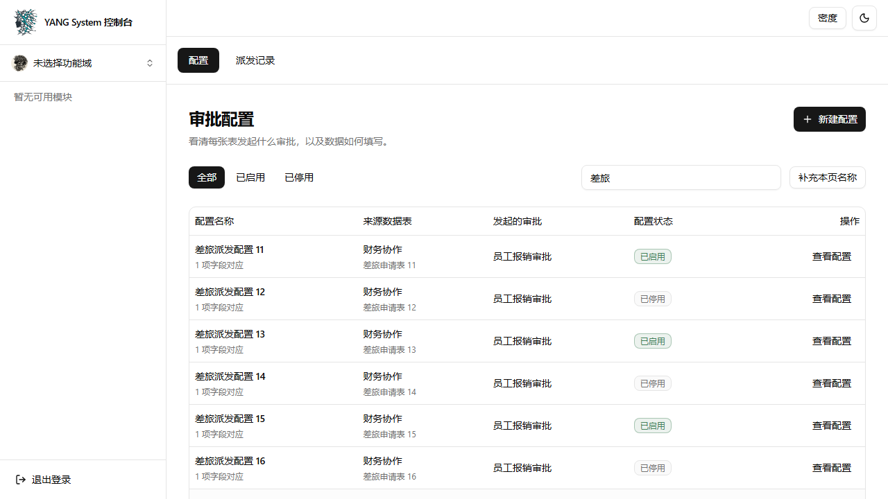
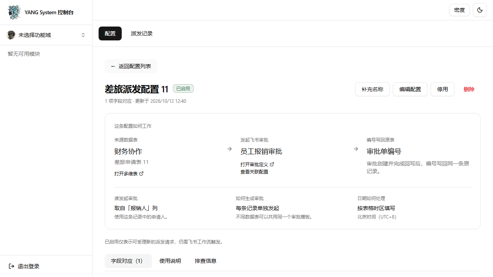

# 审批配置业务视角改版 — 实现验收记录

> 日期：2026-10-12。状态：独立分支已完成本地验收，尚未合并或部署。
> 设计：[已确认方案](../2026-10-12-feishu-approval-config-business-view-design.md)。
> 分支：`codex/approval-config-business-view`；基点：`74ac3fa`；主体实现：`6107472`。
> 工作树：`C:\Users\16040\.codex\worktrees\approval-config-business-view\yang-system`。

## 一、最终行为

| 位置 | 已实现行为 |
|---|---|
| 配置列表 | 以配置名称、来源数据表、审批名称、启停状态识别配置；业务名称搜索、启停筛选和总数由服务端查询，保留真实分页 |
| 查看配置 | 按配置 ID 独立读取，展示来源表、审批、申请人来源、编号回填位置和配置时区；返回列表恢复筛选、页码与滚动位置 |
| 字段对应 | 默认展示中文列名、审批项目、必填标记与中文填写规则；未知类型或规则明确待确认，支持搜索及技术细节展开 |
| 关联配置 | 按审批定义独立查询、分页和计数，展示各来源表与启停状态，不从当前列表页推算 |
| 使用与排查 | 使用说明解释工作流触发及编号回写；长标识、原始转换规则和结构缓存时间集中到排查信息 |
| 管理操作 | 保留创建、编辑、启停确认、删除和派发记录；读写权限、固定坐标及服务端校验沿用当前契约 |
| 异常反馈 | 加载、重试、空列表、无搜索结果、零映射、详情不存在和名称暂缺均有对应反馈；失败不伪装为删除或保存成功 |
| 窄屏 | 复用现有 Dialog 提供导航菜单；390px 下内容可用全宽，菜单可用 Escape 关闭并恢复焦点，标签页支持键盘切换 |

启用只表示允许受理新的派发请求，表单结构缓存时间只表示结构快照时间；页面均明确它们不代表工作流已经接通或审批运行成功。展示名称不参与坐标、派发白名单、字段匹配或编号回写。

## 二、名称快照与兼容性

配置表通过 `fields!` 新增五个可空展示快照：`base_name`、`table_name`、`approval_name`、`applicant_field_name`、`backfill_field_name`。声明式 Schema 按既有机制增量同步，未新增 SQL migration；原有坐标唯一键不变。旧配置和旧响应缺少名称时，前端显示明确的“名称待补充”，仍可通过排查信息核对稳定标识。

创建与字段映射更新复用 provision 的审批定义及字段元数据，并补充表格名称；补充失败保留原值。新增受 `feishu.approval.write` 保护的 `refresh_names`，每批接收 1–10 个正整数配置编号；每批共享 Base 和审批定义请求去重。有效名称与审计在同一事务保存，空白或失败结果不覆盖旧快照，返回排序且去重的未完成编号。OpenAPI 和 TypeScript 契约已由仓库生成器同步。

**实施决策（Ruling）：** 名称补充采用显式批次刷新，不增加后台服务。好处是复用现有取数和事务能力，列表读取本地快照；代价是旧配置需要管理员点击“补充名称”或“补充本页名称”，飞书对象改名后快照可能暂旧。

## 三、本地验证

| 验证 | 实际结果与范围 |
|---|---|
| `python scripts/run_ci.py full` | exit 0；架构、Rust 格式、all-target 测试、Clippy、生产依赖审计、前端完整检查与两套浏览器门禁通过 |
| Rust lib | 965 passed、0 failed、6 ignored；需要真实依赖的 ignored 测试按下面的命令单独执行 |
| Vitest | 72 个文件、773 项通过；审批相关三个聚焦文件另有 96/96 通过记录 |
| 开发环境 Chromium | 21 passed、2 skipped；本次审批列表/详情、关联分页、浏览器返回、窄屏导航与键盘用例均执行并通过 |
| 生产构建 Chromium | 4/4，通过同一组审批页面用例及生产构建/部署响应契约用例 |
| 审批派发真实库集成 | 9/9，覆盖配置 CRUD、业务名称搜索、组合过滤、跨页关联、输入边界、派发请求和任务记录等 |
| 名称刷新真实库集成 | 1/1，真实 MySQL 测试库、Redis DB 15、Registry 调度与审计落库；飞书出站响应由测试 transport 回放 |
| CI runner 自检 | `python scripts/run_ci.py --self-test` 通过；新 ignored 测试已登记到 integration profile |

两项真实库验证命令（使用仓库专用测试库与 Redis DB 15）：

```powershell
cargo test --test feishu_approval_dispatch_integration --locked -- --ignored --test-threads=1
cargo test --lib --locked real_mysql_refresh_names_saves_deduplicates_preserves_and_audits -- --ignored --nocapture
```

名称刷新测试先全量成功，再回放部分权限失败和空白名称：验证五个快照确实保存、共享请求各一次、成功名称更新而失败项保旧、重复与不存在配置编号的返回，以及带 actor/target 的真实审计记录。它证明本地持久化与编排行为，不证明当前飞书账号具备真实取数权限。

本地测试日志保存在 `target/approval-config-verification/`，不纳入提交。完整门禁的最终记录为 `.ci-full-acceptance.log`，名称刷新 GREEN 为 `.ci-refresh-green-final.log`，审批集成为 `.ci-integration-reviewed.log`。

## 四、审查与反向验证

最终整分支审查由独立 reviewer `/root/final_review` 完成：Critical 0、Important 1、Minor 0。唯一 Important 是名称刷新成功编排缺少真实数据库覆盖，已在一次修复中补齐上述集成测试，并在恢复源码后重新通过相关集成和 full 门禁。没有延期 Minor。

| 摘除或变异 | 观察到的失败 | 恢复后的验证 |
|---|---|---|
| 名称刷新上限判断 | 超过 10 条的输入测试变红 | Rust 全量通过 |
| 空白名称判断 | 无效名称回退测试变红 | Rust 全量通过 |
| 外部链接坐标守卫 | 缺失/异常坐标用例变红 | 前端聚焦及全量通过 |
| 前端批次从 10 改为 20 | 分批刷新用例变红 | 前端聚焦及全量通过 |
| Base 请求去重判断 | 共享 Base 请求次数为 2，期望为 1，真实库测试变红 | 恢复后真实库 1/1 与 full 通过 |

窄屏浏览器测试还复现了固定侧栏挤占内容的问题：390px 屏幕的主内容仅 150px。添加内容宽度断言后观察到 RED，复用现有 Dialog 导航后为 GREEN，并重新运行完整门禁。所有临时摘除和变异均已恢复。

Windows 编译曾因页面文件不足失败，验证时设置 `CARGO_BUILD_JOBS=1`；Python 输出使用 `PYTHONUTF8=1`，依赖审计临时使用官方 npm registry。这些是本次验证环境设置，未改变产品配置、门禁规则或业务行为。

## 五、实现截图

以下为实际生产构建页面，接口使用浏览器测试数据回放；业务名称、记录与时间为测试样例，侧栏 Catalog 也是测试 fixture。它们与归档 HTML 原型的截图分开保存。

业务列表：



配置详情：



390×844 窄屏详情：


## 六、未验证边界

本次没有连接真实飞书验证成功取名、工作流触发、审批创建或云端编号回填；没有合并、push 或部署。完整 integration profile 未在本次收尾全部重跑，真实库验证范围为上表两项，共 10 个测试。

未运行冷缓存 Rust 1.80 验证；本次没有新增或升级依赖。生产数据库增量同步和真实凭证权限仍需部署时验证，不能将本地测试和截图解释为生产问题已经解决。
